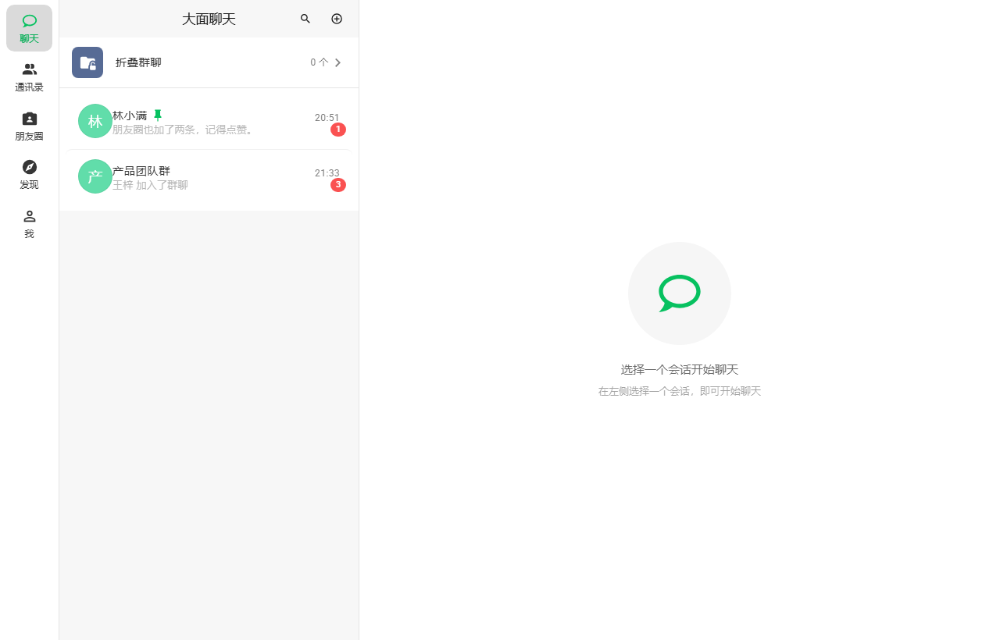
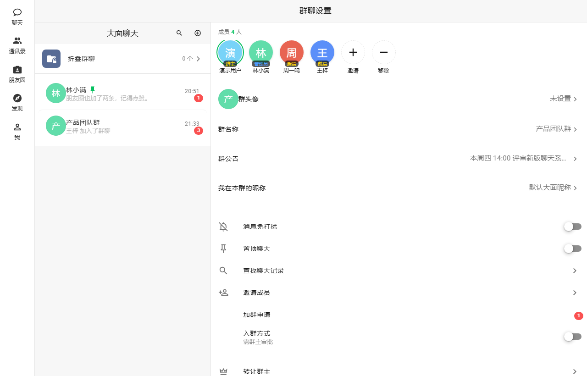
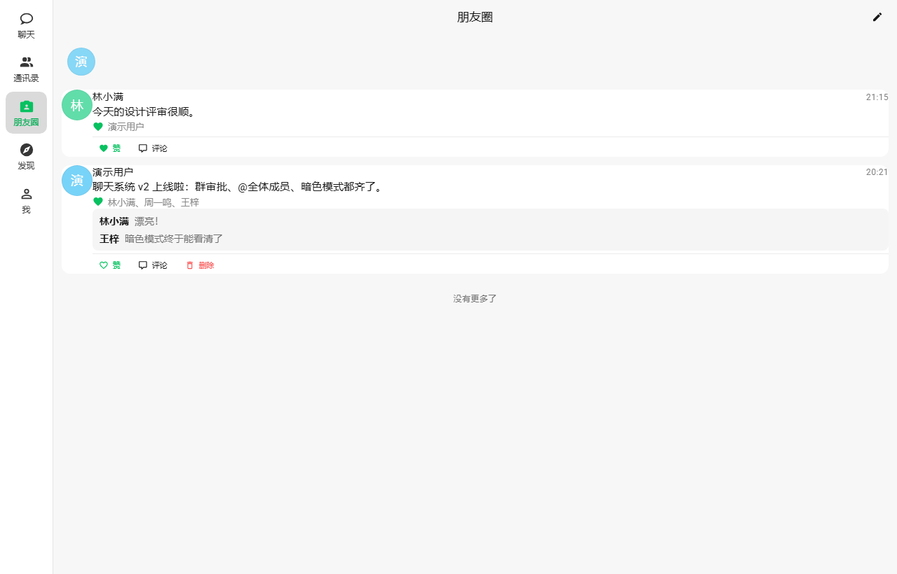
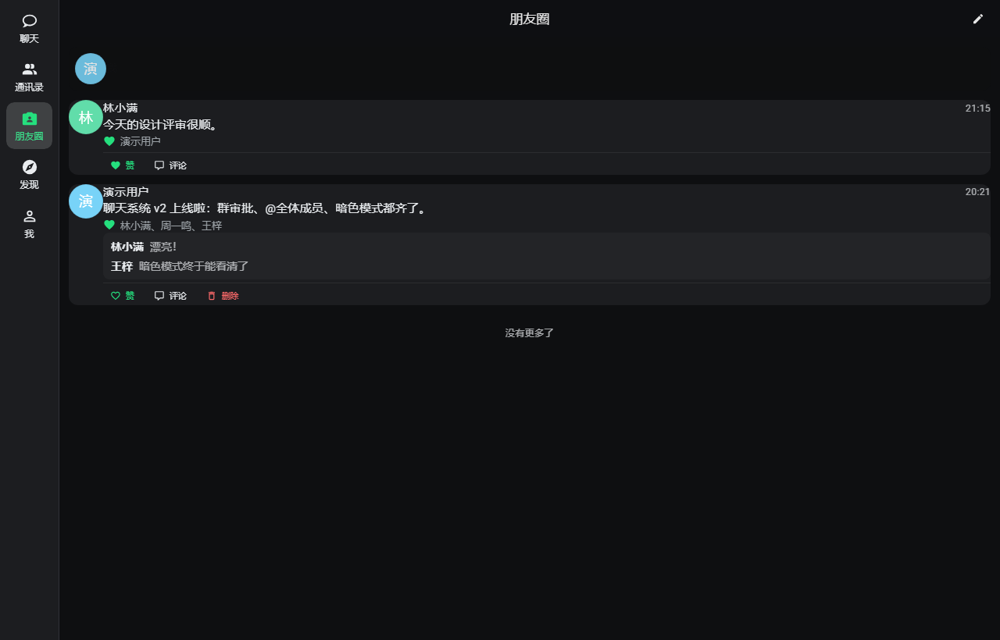

# 大面聊天 · Damian Chat

<sub>**English · 英文** → [README.en.md](./README.en.md)　|　**中文 · Chinese** → [README.zh.md](./README.zh.md)</sub>

[](./LICENSE)
[](https://dotnet.microsoft.com)
[](https://vuejs.org)
[](https://docs.docker.com)
[](docs/%E9%83%A8%E7%BD%B2%E4%B8%8E%E4%BD%BF%E7%94%A8%E6%8C%87%E5%8D%97.md)

> **A self-hosted, WeChat-style instant messenger that runs entirely on your own machine.** 可自托管、类微信的开源即时通讯系统：实时私聊 / 群聊、朋友圈、QQ 式群管理、邮箱注册与微信式「大面号」，并内置一层**深度安全加固**（流量防火墙 · 双验证码 · 隔离式蜜罐 · 全链路成员鉴权 · 管理接口环回双门）。后端 **C# / ASP.NET Core 8 + SignalR**，前端 **Vue 3 + Vuetify 4 + TypeScript**。数据 100% 自持，无云账号、无遥测，开箱即用。

<p align="center">
  
  
  
  
</p>

---

## 为什么选它 / Why this over the alternatives

同类项目里，**大面聊天**的定位是「**像微信一样、但你 100% 自持**」的私有即时通讯。下面这张表帮你在众多相近项目里快速判断它合不合适：

| 需求 | 大面聊天 Damian Chat | 自建 IM（信鸽/Matrix） | 通用群聊（Rocket.Chat / Mattermost） | AI 对话（ChatGPT clone） |
|---|---|---|---|---|
| 像微信的交互（朋友圈 / 拍一拍 / 大面号 / 引用 / 撤回） | ✅ 原生 | ❌ | ❌ | ❌ |
| 实时私聊 + 群聊（WebSocket） | ✅ SignalR | ✅ | ✅ | — |
| **数据完全自持**（无云 / 无 SaaS / 无遥测） | ✅ 仅本机 | ⚠️ 视实现 | ⚠️ 常需云 | ⚠️ 常需云 |
| **开箱即用的安全加固**（防火墙 + 蜜罐 + 双验证码 + 环回管理门） | ✅ 内置 | ❌ 需自研 | ⚠️ 基础 | ❌ |
| **单文件 / 一键部署**（后端内置前端，一条 Docker） | ✅ | ⚠️ | ⚠️ 多服务 | ⚠️ |
| 图形化管理端（Windows 托盘 GUI） | ✅ 自带 | ❌ | ⚠️ 网页 | ❌ |
| QQ 式加群 + 全员/限时禁言 + 群投票 | ✅ | ❌ | ⚠️ 部分 | ❌ |
| 中英双语 + 个性化（主题 / 暗色 / 字号 / 离线缓存） | ✅ | ❌ | ⚠️ | ❌ |

**适合你的场景**：想在局域网 / 私有服务器给团队、家庭、社区做一个「**自己的微信**」，要实时、要安全、要数据不出本机、还要好看好用——而**不想自己从零拼 IM 协议、不想要 SaaS 订阅**。

- 💬 **类微信交互** — 私聊 / 群聊、朋友圈、拍一拍、引用回复、@成员 / @全体、消息撤回 / 转存。
- 🏷️ **微信式「大面号」** — 邮箱验证码注册（SMTP）或账号直注；随机大面号默认搜不到（同微信 `wxid` 机制，防批量加人），可改自定义号（冷却天数可配）。
- 👥 **QQ 式群管理** — 按群号加群（开放 / 答题 / 审批 / 关闭），全员禁言 / 按人限时禁言（10 分钟~永久），群投票，拒绝可附理由。
- 🛡️ **深度安全加固（内置零配置）** — 流量防火墙（按 IP 并发 / 速率 / 带宽 + 自动封禁）+ 身份维度消息洪泛上限、滑块 + 图形双验证码、httpOnly 刷新令牌、隔离式 Web 蜜罐 + 金丝雀、敏感词过滤、`/api/admin/*` 环回 + 密钥双门。
- 🖥️ **图形化管理端** — Windows WPF 托盘常驻：启停 / 改端口 / 在线用户 / 安全策略 / 用户管理 / 日志反馈。
- 🌐 **中英双语 + 个性化** — 一键切换语言；主题色 / 暗色 / 字号 / 离线 Service Worker 缓存，跨刷新保留。

---

## 30 秒快速开始 / Quick start

**方式一 · Windows 一键启动（推荐）**
```bat
启动.bat
```

**方式二 · Docker（Linux / 服务器）**
```bash
docker build -t damian-chat .
docker run -d -p 8080:8080 -v damian-data:/app/data damian-chat
# → http://localhost:8080
```

**方式三 · 直接跑后端（需 .NET 8 SDK）**
```bash
cd server/WeChatWeb && dotnet run
```

完整部署、HTTPS 加密、首个账号、日常运维、排障详见 👉 **[《部署与使用指南》](docs/部署与使用指南.md)**。

---

## 功能总览 / Features

- **聊天**：私聊 1v1、多人群聊；文本 / 图片（等比 + 预览）/ 语音 / 文件；撤回 / 引用回复 / 转存 / 删除；拍一拍 / @成员 / @全体 / 群公告 + 确认回执；群投票（单选 / 多选、实时票数、可截止）；会话置顶 / 免打扰 / 折叠，多端 IndexedDB 缓存 + 离线兜底。
- **社交**：账号 / 邮箱注册（双验证码 + 强度策略 + 失败锁定）；大面号体系 + 绑定 / 换绑邮箱；「添加我的方式」搜索隐私开关；头像 / 昵称 / 签名 / 地区 / 性别隐私开关；朋友圈（图文 + 点赞 + 评论）。
- **管理**：在线用户实时查看、封禁 / 解封（即时踢线）、创建 / 删除用户（级联清理）、重置密码（即时吊销令牌）、安全策略热改、SMTP 测试邮件、用户反馈收集、日志 / 控制台。
- **安全（内置）**：见上「为什么选它」第 4 条；另含群号不可枚举、非成员全入口 404/403、封号删号即时 Abort 在线连接。

---

## 文档地图 / Docs

| 文档 | 内容 |
|---|---|
| [📖 部署与使用指南](docs/部署与使用指南.md) | **从零到上线**：三种部署方式、HTTPS、首个账号、管理端运维、排障、配置参考（中文详版） |
| [中文 README](./README.zh.md) | 功能 / 技术栈 / 目录结构 / 安全说明 |
| [English README](./README.en.md) | English feature / architecture / security |
| [Release 产物](https://github.com/Damianjiang/damian-chat/releases) | Windows x64 一键运行包（自带前端 + 管理端 GUI） |

**技术栈**：后端 C# / .NET 8 · ASP.NET Core · SignalR · JWT · 自研中间件；前端 Vue 3 · Vuetify 4 · Pinia · TypeScript · Vite；实时 @microsoft/signalr（WebSocket）；媒体 IndexedDB blob 缓存；管理端 WPF。前端产物直接打进后端 `wwwroot`，**部署 / 运行只需 .NET 后端，无需常驻 Node**。

---

## License

以 [MIT License](./LICENSE) 开源。
