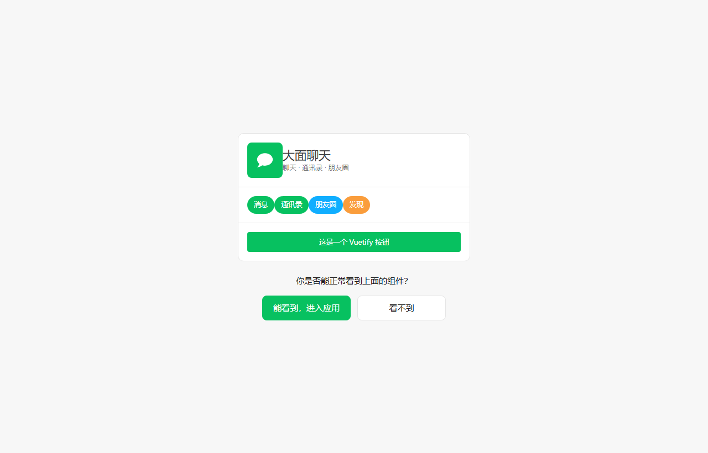

# 大面聊天 · Damian Chat

[](./LICENSE)
[](https://dotnet.microsoft.com)
[](https://vuejs.org)
[](https://www.typescriptlang.org)
[](https://docs.docker.com)
[](https://github.com/Damianjiang/damian-chat/issues)

A **self-hosted, WeChat-style instant messaging platform** with real-time group chat, private chat, Moments (朋友圈), rich media, and a hardened security layer — built with **C# ASP.NET Core 8 + SignalR** on the backend and **Vue 3 + Vuetify 4 + TypeScript** on the frontend.

一个 **可自托管的、类微信的即时通讯系统**：实时群聊 / 私聊、朋友圈、富媒体消息，并内置一层**安全加固**——后端 **C# ASP.NET Core 8 + SignalR**，前端 **Vue 3 + Vuetify 4 + TypeScript**，开箱即用，无需依赖任何第三方 SaaS。

> 完全开源 · 本地部署 · 数据只在你自己的机器上 / Fully open source · self-hosted · your data never leaves your machine.

---

## 项目亮点 Highlights

- 🔐 **数据自持（Data ownership）**：所有用户、聊天、文件都保存在你自己的目录里，没有云账号、没有遥测。
- ⚡ **实时通讯（Realtime）**：基于 SignalR 的 WebSocket 实时推送，新消息、撤回、入群、成员变动即时同步。
- 🛡️ **深度安全加固（Security hardening）**：
  - 流量防火墙（按 IP 并发 + 速率 + 自动封禁），防 DDoS / 刷接口；
  - 身份维度消息洪泛上限（防"偷 token + 换 IP"绕过 IP 限流）；
  - refresh 令牌走 **httpOnly cookie**（防 XSS 偷长效凭证），访问令牌 2h 短时效；
  - 滑块 + 图形双验证码登录，登录失败锁定、防爆破；
  - **隔离式 Web 蜜罐**（假 `.env`/`.git`/管理台 + 金丝雀 + tarpit 拖延），对真实用户零误伤；
  - 群 / 消息 / 会话全入口成员校验（群 id 为不可枚举 GUID），非成员一律 404/403；
  - 敏感词过滤、密码强度策略、管理接口环回 + 密钥双重门。
- 🎨 **贴近微信的交互（WeChat-like UX）**：会话列表、群成员宫格、拍一拍、引用回复、@成员、@全体成员、暗色模式、字号个性化、离线 Service Worker 缓存。
- 🖥️ **图形化管理端（Admin GUI）**：WPF 托盘常驻管理工具，一键启停服务、改端口、看在线用户、改安全策略、管用户、看日志/反馈。

---

## 功能总览 Features

### 聊天 Messaging
- 私聊 1v1、多人群聊；
- 文本、图片（等比缩放 + 点击预览）、语音、文件、位置占位；
- 消息**撤回**、**引用回复**、**转存**、**删除**；
- 群聊**拍一拍**、**@成员**、**@全体成员**、群公告 + 确认回执；
- **QQ 式按群号加群**：开放群直接进 / 审批群等群主通过，群号可一键复制；
- 会话**置顶 / 免打扰 / 折叠**，多端 IndexedDB 本地缓存 + 离线兜底。

### 个人与社交 Profile & Social
- 注册 / 登录（双验证码 + 强度策略 + 失败锁定）；
- 头像、昵称、个性签名、性别、地区、手机号隐私开关；
- 通讯录 + 好友关系，成员资料卡；
- **朋友圈（Moments）**：发布图文 / 媒体，点赞与评论；
- 个性化：主题色、暗色模式、半透明、背景、字号（小/标准/大/特大，跨刷新保留）。

### 管理 Admin
- 在线用户实时查看、封禁 / 解封；
- 用户与群的管理、公告 / 确认；
- 安全策略热改（限流、封禁阈值、蜜罐开关）；
- 反馈收集 + 删除、日志 / 控制台查看。

---

## 界面展示 Screenshots

<details>
<summary>登录 / 主界面 / 群聊 / 私聊 / 朋友圈 / 通讯录 / 暗色模式（点击展开）</summary>

| 登录 Login | 聊天列表 Chat list |
|---|---|
|  |  |

| 群聊 · 群设置 Group & settings | 私聊 Private chat |
|---|---|
|  |  |

| 朋友圈 Moments | 通讯录 Contacts |
|---|---|
|  |  |

| 暗色模式 Dark mode |
|---|
|  |

</details>

> 群设置页里的「加群申请」与「入群方式 · 需群主审批」对应后端的 QQ 式加群机制（开放群直接进 / 审批群等群主通过，群号可一键复制）；暗色模式下自己发送的消息气泡使用主题变量，亮/暗都清晰可读。
> The group-settings page shows the "join request" + "join policy (owner approval)" QQ-style flow; in dark mode your own message bubbles follow the theme so they stay readable in both light and dark.

---

## 技术栈 Stack

| 层 Layer | 技术 Tech |
|---|---|
| 后端 Backend | C# / .NET 8 · ASP.NET Core · SignalR · JWT · 自研中间件 |
| 前端 Frontend | Vue 3 · Vuetify 4 · Pinia · TypeScript · Vite |
| 实时 Realtime | @microsoft/signalr（WebSocket） |
| 媒体 Media | 前端 IndexedDB blob 缓存 · 服务端文件库 |
| 管理端 GUI | WPF（.NET 8 Windows）· 托盘常驻 |
| 构建 Build | .NET SDK · Vite 7 · vue-tsc |

> 前端产物由 Vite 直接输出到后端 `wwwroot`，**部署/运行只需要 .NET 后端，无需 Node 常驻**。
> The frontend bundle is emitted straight into the backend `wwwroot` — **at runtime you only need the .NET backend, no Node process required**.

---

## 目录结构 Repository layout

```
.
├── server/                  后端 .NET 解决方案
│   ├── WeChatWeb/           ASP.NET Core 主服务（控制器 / Hubs / 中间件 / 服务）
│   │   ├── Controllers/     REST API（鉴权 / 用户 / 会话 / 群 / 朋友圈 / 文件 / 管理 …）
│   │   ├── Hubs/            SignalR ChatHub（实时推送 / 在线连接管理）
│   │   ├── Middleware/      防火墙 / 限流 / 蜜罐 / 日志 / 安全响应头 …
│   │   ├── Services/        JWT / 密钥 / 验证码 / 敏感词 / 蜜罐 / 反馈 / 看门狗 …
│   │   └── Models/          实体（User / Group / Message / Moment …）
│   ├── WxAdminGui/          WPF 图形管理端（托盘常驻）
│   ├── WxAdmin/             命令行管理工具
│   └── Shared/              跨工程共享（管理密钥读取）
├── web/                     前端 Vue 3 工程
│   ├── src/
│   │   ├── views/           登录页 + 主框架内各面板（会话 / 群 / 朋友圈 / 设置 …）
│   │   ├── components/     消息气泡 / 输入工具条 / 滑块验证码 / 头像 …
│   │   ├── stores/          Pinia：auth / conversations / contacts / moments / theme
│   │   ├── lib/             api / signalr / idb / files / theme / personalize …
│   │   └── styles/          微信风 SCSS + Vuetify 主题
│   └── public/              Service Worker / 启动脚本 / PWA 清单
├── 启动.bat                 一键启动（拉起管理端 → 启动服务）
└── 停止.bat                 一键停止（按配置端口清理监听）
```

---

## 快速开始 Quick start

### 前置条件 Prerequisites
- **Windows**（管理端 GUI 为 WPF；核心后端跨平台，GUI 仅 Windows）；
- **.NET 8 SDK**（`dotnet --version` 确认）；
- 可选：浏览器访问 `http://<局域网IP>:<端口>`。

### 方式一 · 一键启动（推荐）
```bat
启动.bat
```
它会：编译并拉起图形管理端（若未编译）→ 管理端自动启动后端服务 → 打印局域网访问地址。关闭管理端窗口 = 最小化到托盘后台常驻。

### 方式二 · 直接跑后端
```bat
cd server\WeChatWeb
dotnet run
```
前端默认由后端 `wwwroot` 同源托管（先构建前端，见下）。

### 前端构建（可选，默认已随仓库就绪）
```bat
cd web
npm install
npm run build-only     # 产物输出到 server\WeChatWeb\wwwroot
```

### 停止
```bat
停止.bat
```

### 方式三 · Docker 容器（Linux / 服务器 / 跨平台）
仓库根目录自带多阶段 `Dockerfile`（前端构建 + 后端发布 + 运行时三阶段，前端产物并入后端 `wwwroot` 自包含托管）：
```bash
docker build -t damian-chat .
docker run -d --name damian-chat \
  -p 8080:8080 \
  -v damian-chat-data:/app/data \
  -v damian-chat-logs:/app/logs \
  damian-chat
# → http://localhost:8080
```
- 用户数据 / 密钥 / 聊天文件都落在 `data` 卷（`/app/data`），日志在 `logs` 卷（`/app/logs`），**重启不丢数据**；
- 端口可用 `ASPNETCORE_URLS` 覆盖；需要 HTTPS 时设 `WX_HTTPS_CERT`（PFX）+ `WX_HTTPS_CERT_PASSWORD` + `WX_HTTPS_PORT`；
- 图形管理端（WPF）为 Windows 专属，容器内不含——管理接口本身可用 HTTP API（`/api/admin/*`）操作。

> 端口统一以管理端配置为准；首次运行会在 `server/WeChatWeb/data/` 下生成密钥与数据目录（这些目录已被 `.gitignore` 排除，不在仓库中）。
> The port is managed by the admin tool; on first run a `data/` folder with generated keys is created (excluded from the repo).

---

## 安全说明 Security notes

本系统把「聊天数据留在你自己的机器上」作为前提，并在其上叠加了一整套面向攻击场景的加固。以下都是**产品内置、无需额外配置**的安全能力。
The system treats "your chat data stays on your own machine" as a premise, then layers a hardening stack aimed at real attack scenarios. Everything below is **built-in and requires no extra configuration**.

- **数据不出本机 / Data never leaves your machine** — 用户、聊天、文件全部落盘在你的 `data/` 目录，没有云账号、没有遥测、没有第三方回调。No cloud accounts, no telemetry, no third-party callbacks.
- **密钥首次启动本地生成 / Keys generated locally on first run** — JWT 签名密钥与管理密钥在服务首次启动时随机生成并写在本地，**源码与仓库里不含任何可用密钥**。JWT and admin keys are randomly generated on first start; no usable secret is ever shipped in source or the repo.
- **登录防爆破 / Login anti-brute-force** — 滑块 + 图形双验证码、失败锁定、图形/滑块背景图库可替换；密码走 PBKDF2 加盐哈希 + 强度策略。Dual slider + image captcha, lockout on repeated failure, PBKDF2 salted password hashing with strength policy.
- **限流与 DDoS 防护 / Rate limiting & DDoS defense** — 按 IP 的并发/速率限制与自动封禁，叠加**身份维度**消息洪泛上限（防止"偷 token 后换 IP"绕过 IP 限流）。Per-IP concurrency/rate caps with auto-ban, plus a per-identity message-flood limit so a stolen token + IP rotation can't bypass IP limits.
- **长效凭证走 httpOnly Cookie / Long-lived creds in httpOnly cookie** — refresh token 存在 httpOnly cookie，防 XSS 直接窃取；访问 token 仅 2 小时短时效。Refresh tokens live in httpOnly cookies (XSS-resistant); access tokens expire in 2 hours.
- **群/消息/会话全入口鉴权 / Per-entrypoint authorization** — 群号是不可枚举 GUID，非成员读群/读消息/发消息一律 404/403；拉群成员只能拉自己的好友，改角色仅群主，审批仅群主/管理员。Group IDs are non-enumerable GUIDs; non-members get 404/403 on every read/write; you can only add your own contacts; role changes are owner-only; join approvals are owner/admin-only.
- **敏感词过滤 + 管理接口环回双门 / Sensitive-word filter + loopback-gated admin API** — 消息入口做敏感词剥离；`/api/admin/*` 仅接受环回请求且需本地管理密钥。Inbound sensitive-word stripping; `/api/admin/*` only accepts loopback requests **and** requires the local admin key.
- **隔离式 Web 蜜罐 / Isolated web honeypot** — 诱饵 `.env`/`.git`/管理台 + 金丝雀 + tarpit 拖延，只读、与真实系统完全隔离，对正常用户零误伤。A read-only, fully isolated honeypot with canaries and tarpit delay; zero impact on real users.
- **封号/删号即时踢线 / Instant ban/delete disconnect** — 已认证请求按 sub 反查封禁状态，命中即 `Abort` 其在线连接，不等心跳。Authenticated requests re-check ban status by subject; a hit immediately aborts the live connection.

> **生产部署建议 / Production tips**：置于 HTTPS 之后（设 `WX_HTTPS_CERT`）、把管理接口限制在环回、按网络环境调整 `security.json` 的限流阈值与封禁线。
> Put it behind HTTPS (`WX_HTTPS_CERT`), keep the admin API loopback-only, and tune the rate/ban thresholds in `security.json` for your network.

---

## License

本项目以 **MIT License** 开源，详见 [`LICENSE`](LICENSE)。

---

## 目录 · Contents

- [项目亮点](#项目亮点-highlights) · [Highlights](#项目亮点-highlights)
- [功能总览](#功能总览-features) · [Features](#功能总览-features)
- [界面展示](#界面展示-screenshots) · [Screenshots](#界面展示-screenshots)
- [技术栈](#技术栈-stack) · [Stack](#技术栈-stack)
- [目录结构](#目录结构-repository-layout) · [Repository layout](#目录结构-repository-layout)
- [快速开始](#快速开始-quick-start) · [Quick start](#快速开始-quick-start)
- [安全说明](#安全说明-security-notes) · [Security notes](#安全说明-security-notes)
- [License](#license)
