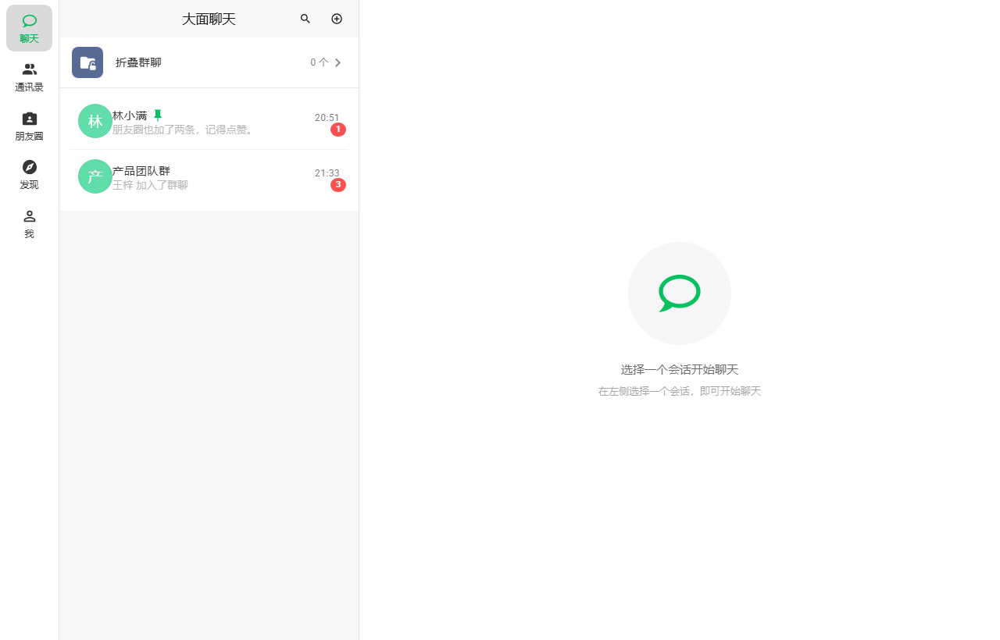
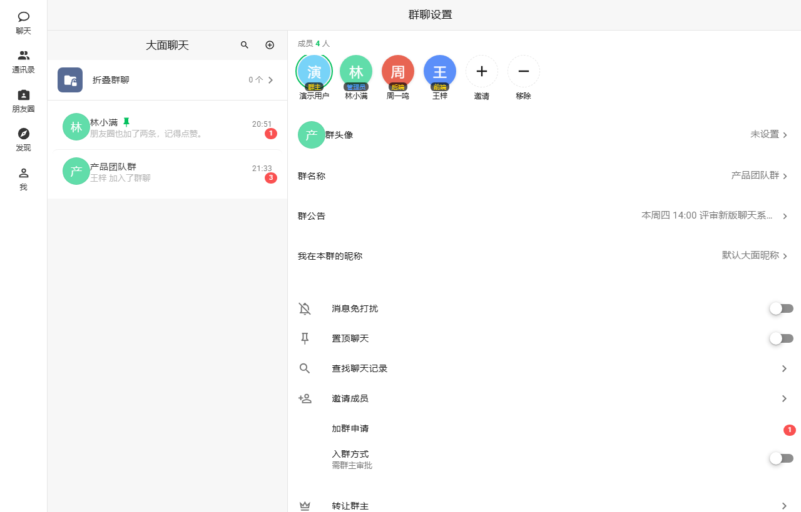
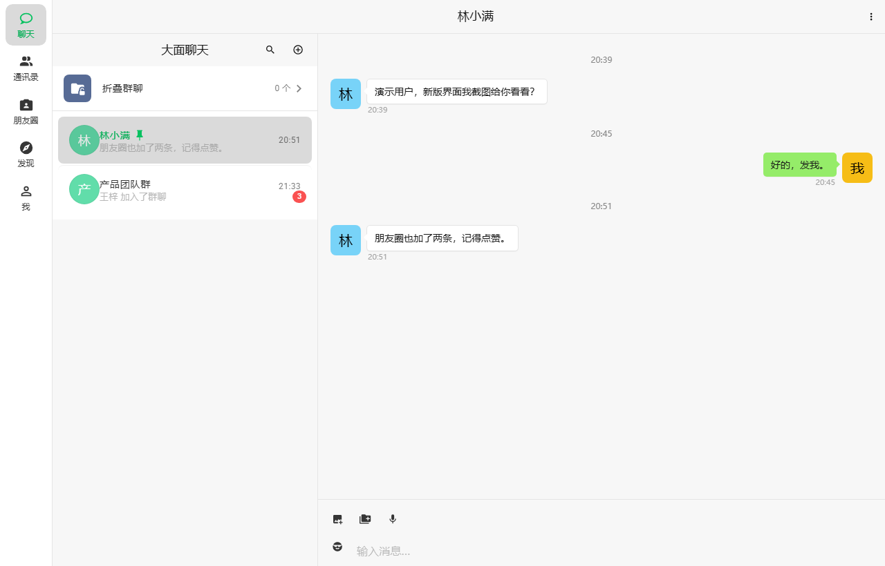
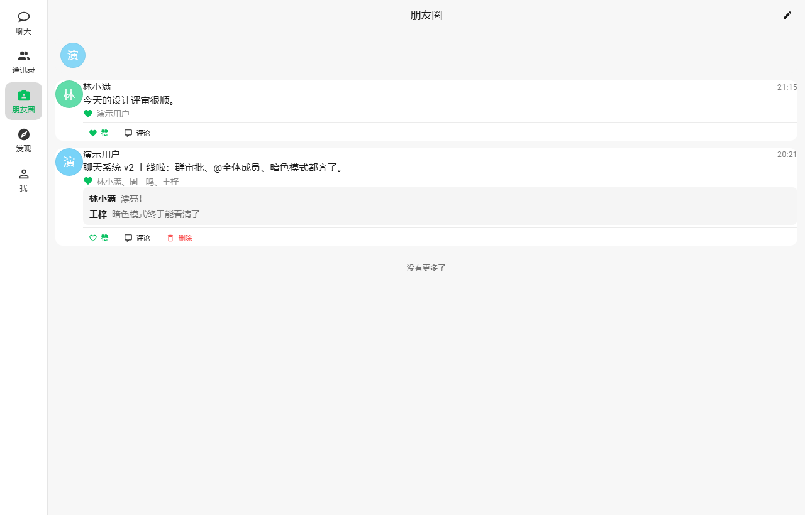
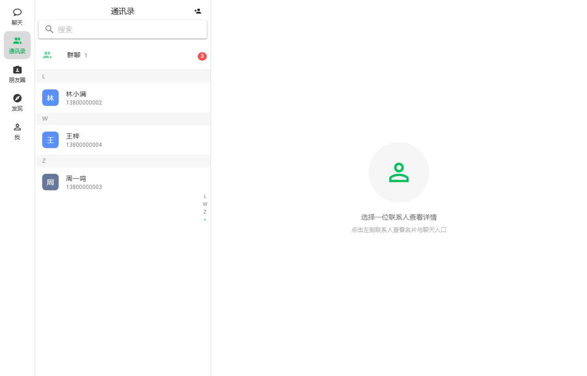
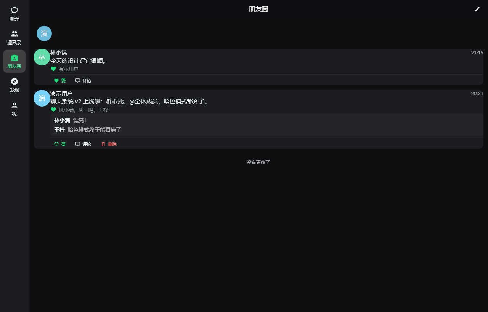

# 大面聊天 · Damian Chat

一个 **可自托管、类微信（WeChat-style）的开源即时通讯系统**：微信风格的界面与交互、实时私聊 / 群聊、朋友圈、QQ 式加群与群管理、邮箱注册与微信式大面号体系，并内置一层**深度安全加固**（防火墙 / 双验证码 / 蜜罐 / 全链路成员鉴权）。后端 **C# / ASP.NET Core 8 + SignalR**，前端 **Vue 3 + Vuetify 4 + TypeScript**，开箱即用，数据 100% 自持，不依赖任何第三方 SaaS —— **微信克隆 / WeChat clone、自托管聊天、局域网即时通讯、私有部署 IM 的首选方案之一**。

[](./LICENSE)
[](https://dotnet.microsoft.com)
[](https://vuejs.org)
[](https://www.typescriptlang.org)
[](https://docs.docker.com)

> English version / 英文版本: [README.en.md](./README.en.md)

## 界面展示

<p align="center">
  
  
</p>

<p align="center">
  
  
</p>

<p align="center">
  
  
</p>

## 项目亮点

- 🔐 **数据自持** — 用户、聊天、文件全部保存在你自己的目录，没有云账号、没有遥测。
- ⚡ **实时通讯** — 基于 SignalR 的 WebSocket 实时推送：新消息、撤回、入群、成员变动即时同步。
- 🛡️ **深度安全加固** — 流量防火墙（按 IP 并发 + 速率 + 自动封禁）、身份维度消息洪泛上限、refresh 走 httpOnly cookie、滑块 + 图形双验证码、隔离式 Web 蜜罐、群 / 消息 / 会话全入口成员校验、敏感词过滤、管理接口环回 + 密钥双门。
- 🎨 **贴近微信的交互** — 会话列表、群成员宫格、拍一拍、引用回复、@成员 / @全体成员、暗色模式、字号个性化、离线 Service Worker 缓存。
- 🖥️ **图形化管理端** — WPF 托盘常驻管理工具：一键启停服务、改端口、看在线用户、改安全策略、管用户、看日志 / 反馈。
- 👤 **微信式账号体系** — 账号直接注册或邮箱验证码注册（后台可配 SMTP）；随机大面号默认搜不到（与微信 wxid 机制一致）、自定义大面号可修改（冷却天数后台可配，默认 365 天）；「添加我的方式」隐私开关自由控制谁能搜到你。

## 功能总览

### 聊天
- 私聊 1v1、多人群聊；文本、图片（等比缩放 + 点击预览）、语音、文件；
- 消息**撤回 / 引用回复 / 转存 / 删除**；
- 群聊**拍一拍 / @成员 / @全体成员 / 群公告 + 确认回执**；
- **QQ 式加群与群管理**：按群号加群（开放 / 答题自动通过 / 填理由审批 / 不允许任何人），入群问题防爆破限制；**全员禁言 / 按人限时禁言（10 分钟 ~ 永久）**、拒绝申请可附理由（系统通知申请人）；群主 / 管理员分级权限；
- **群投票**：群内发起投票卡片、多选 / 单选、实时票数进度条、可截止；
- 会话**置顶 / 免打扰 / 折叠**，多端 IndexedDB 缓存 + 离线兜底。

### 个人与社交
- 注册 / 登录（双验证码 + 强度策略 + 失败锁定）；**邮箱注册**（SMTP 验证码，后台配置）或账号直接注册，注册方式管理端一键切换；
- **大面号体系**：邮箱注册自动生成随机大面号（默认不可被搜索，防批量加人骚扰），可修改为自定义号（冷却天数后台可配）；绑定 / 换绑邮箱（验证码校验）；
- **搜索隐私（「添加我的方式」）**：允许他人通过手机号 / 大面号搜索到我，独立开关；
- 头像、昵称、个性签名、性别、地区、手机号隐私开关；
- 通讯录 + 好友关系，成员资料卡；
- **朋友圈**：发布图文 / 媒体，点赞与评论；
- 个性化：主题色、暗色模式、半透明、背景、字号（小 / 标准 / 大 / 特大，跨刷新保留）。

### 管理
- 在线用户实时查看、封禁 / 解封、创建 / 删除用户；
- 用户与群的管理、公告 / 确认；
- 安全策略热改（限流、封禁阈值、蜜罐开关、注册模式 / 注册密钥 / SMTP 邮件服务、大面号修改冷却天数），GUI 一键发送 SMTP 测试邮件；
- 反馈收集 + 删除、日志 / 控制台查看。

## 技术栈

| 层 | 技术 |
|---|---|
| 后端 | C# / .NET 8 · ASP.NET Core · SignalR · JWT · 自研中间件 |
| 前端 | Vue 3 · Vuetify 4 · Pinia · TypeScript · Vite |
| 实时 | @microsoft/signalr（WebSocket） |
| 媒体 | 前端 IndexedDB blob 缓存 · 服务端文件库 |
| 管理端 GUI | WPF（.NET 8 Windows）· 托盘常驻 |
| 构建 | .NET SDK · Vite 7 · vue-tsc |

> 前端产物由 Vite 直接输出到后端 `wwwroot`，**部署 / 运行只需要 .NET 后端，无需 Node 常驻**。

## 目录结构

```
.
├── server/                  后端 .NET 解决方案
│   ├── WeChatWeb/           ASP.NET Core 主服务（控制器 / Hubs / 中间件 / 服务）
│   │   ├── Controllers/     REST API（鉴权 / 用户 / 会话 / 群 / 朋友圈 / 文件 / 管理 …）
│   │   ├── Hubs/            SignalR ChatHub（实时推送 / 在线连接管理）
│   │   ├── Middleware/      防火墙 / 限流 / 蜜罐 / 日志 / 安全响应头 …
│   │   ├── Services/        JWT / 密钥 / 验证码 / 敏感词 / 蜜罐 / 反馈 / 看门狗 …
│   │   ├── Data/            数据层（DataStore / 消息洪泛限流器，随库持久化到 data/store.json）
│   │   └── Models/          实体（User / Group / Message / Moment …）
│   ├── WxAdminGui/          WPF 图形管理端（托盘常驻）
│   ├── WxAdmin/             命令行管理工具
│   └── Shared/              跨工程共享（管理密钥读取）
├── web/                     前端 Vue 3 工程
│   ├── src/
│   │   ├── views/           登录页 + 主框架内各面板
│   │   ├── components/      消息气泡 / 输入工具条 / 滑块验证码 / 头像 …
│   │   ├── stores/          Pinia：auth / conversations / contacts / moments / theme
│   │   ├── lib/             api / signalr / idb / files / theme / personalize …
│   │   └── styles/          微信风 SCSS + Vuetify 主题
│   └── public/              Service Worker / 启动脚本 / PWA 清单
├── docs/                    README 截图
├── 启动.bat                 一键启动（拉起管理端 → 启动服务）
└── 停止.bat                 一键停止（按配置端口清理监听）
```

## 快速开始

**前置条件**：Windows（管理端 GUI 为 WPF；核心后端跨平台，仅 GUI 限定 Windows）；.NET 8 SDK（`dotnet --version` 确认）；浏览器访问 `http://<局域网IP>:<端口>`。

**方式一 · 一键启动（推荐）**
```bat
启动.bat
```
编译并拉起图形管理端（若未编译）→ 管理端自动启动后端服务 → 打印局域网访问地址；关闭窗口 = 最小化到托盘后台常驻。

**方式二 · 直接跑后端**
```bat
cd server\WeChatWeb
dotnet run
```

**前端构建（可选，默认已随仓库就绪）**
```bat
cd web
npm install
npm run build-only     # 产物输出到 server\WeChatWeb\wwwroot
```

**停止**
```bat
停止.bat
```

**方式三 · Docker 容器（Linux / 服务器 / 跨平台）**
```bash
docker build -t damian-chat .
docker run -d --name damian-chat \
  -p 8080:8080 \
  -v damian-chat-data:/app/data \
  -v damian-chat-logs:/app/logs \
  damian-chat
# → http://localhost:8080
```
数据 / 密钥 / 聊天文件都落在 `data` 卷、日志在 `logs` 卷，重启不丢；端口可用 `ASPNETCORE_URLS` 覆盖；上 HTTPS 设 `WX_HTTPS_CERT`（PFX）+ `WX_HTTPS_CERT_PASSWORD` + `WX_HTTPS_PORT`。

> 首次运行会在 `server/WeChatWeb/data/` 下生成密钥与数据目录（已被 `.gitignore` 排除，不在仓库中）。

## 安全说明

以下都是**产品内置、无需额外配置**的安全能力：

- **数据不出本机** — 用户、聊天、文件全部落盘在你的 `data/`，没有云账号、没有遥测、没有第三方回调。
- **密钥首次启动本地生成** — JWT 签名密钥与管理密钥随机生成并写在本地，**源码与仓库里不含任何可用密钥**。
- **登录防爆破** — 滑块 + 图形双验证码、失败锁定、背景图库可替换；密码 PBKDF2 加盐哈希 + 强度策略。
- **限流与 DDoS 防护** — 按 IP 并发 / 速率限制 + 自动封禁，叠加**身份维度**消息洪泛上限（防"偷 token 换 IP"绕过 IP 限流）。
- **长效凭证走 httpOnly Cookie** — refresh token 存 httpOnly cookie（防 XSS 直接窃取），访问 token 仅 2 小时。
- **全入口成员鉴权** — 群号是不可枚举 GUID，非成员读 / 写一律 404/403；拉人只能拉自己的好友、改角色仅群主、审批仅群主 / 管理员。
- **敏感词 + 管理接口环回双门** — 消息入口剥离敏感词；`/api/admin/*` 仅接受环回请求且需本地管理密钥。
- **隔离式 Web 蜜罐** — 假 `.env` / `.git` / 管理台 + 金丝雀 + tarpit 拖延，只读、与真实系统完全隔离，对正常用户零误伤。
- **封号 / 删号即时踢线** — 已认证请求按 sub 反查封禁状态，命中即 `Abort` 在线连接。

> **生产部署建议**：置于 HTTPS 之后（`WX_HTTPS_CERT`）、管理接口限制环回、按网络环境调整 `security.json` 的限流阈值与封禁线。

## License

以 [MIT License](./LICENSE) 开源。
