# Damian Chat · Feature Gallery (every screen, real screenshots)

This page shows **each core feature screen** with a real screenshot from a clean demo instance
(demo accounts 1/2/3 + one group + moments + mixed message types), so you can see
**what it looks like and where to operate**. No real user data is included — the demo
accounts are deleted after capture.

> 中文版 / Chinese version: [📸 功能一览](功能一览.md) · Full deployment guide: [部署与使用指南](部署与使用指南.md)

## Contents

| # | Screen |
|---|---|
| 1 | Login / Register |
| 2 | Chat main screen (conversation list) |
| 3 | Private chat (text / quote / image / voice / emoji) |
| 4 | Group chat message stream (@member / pat / poll) |
| 5 | Group settings (members / announcement / mute / in-group nickname) |
| 6 | Contacts |
| 7 | Moments (post / like / comment) |
| 8 | Discover (join-by-number / search entry) |
| 9 | Global search |
| 10 | My profile |
| 11 | Settings (theme / font size / privacy / feedback) |
| 12 | Dark mode |
| 13 | Mobile responsive layout |

---

## 1. Login / Register

First use requires registering or logging in (open registration needs the admin-issued
**registration key**, or email-code registration configured in the backend).
Version badge (top-right), dual slider + image captcha, and failure lockout are all on this screen.

  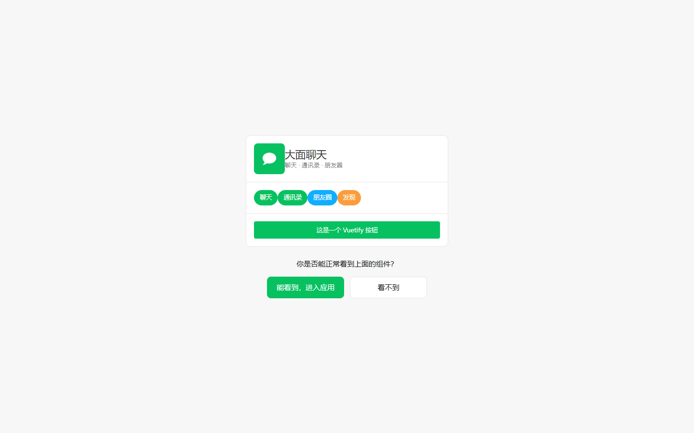

## 2. Chat main screen (conversation list)

Left rail: Chat / Contacts / Moments / Discover / Me. Center is the session list with
**foldable groups**, unread badges, and pinning. The right pane shows
"select a conversation to start chatting" until you open one.

  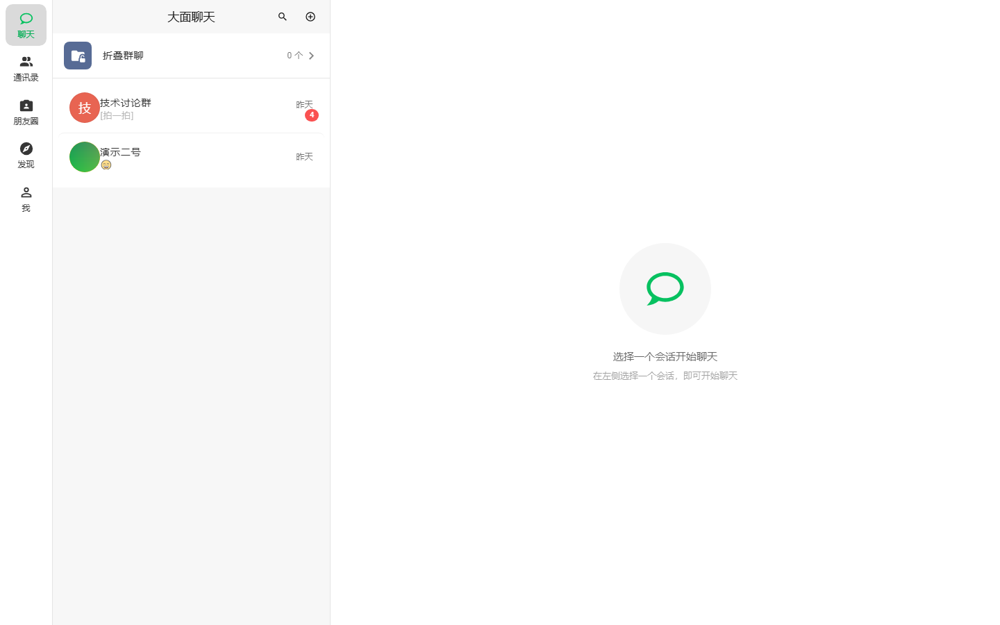

## 3. Private chat

1v1 realtime: text, **quote reply**, **image** (aspect-fit + click-to-preview), **voice**
clip, emoji. The input toolbar (image / file / voice / emoji) is always at the bottom.
**Pat-a-pat now works in private chats too**: double-tap the other avatar, or right-click /
long-press the other party's message and pick **"Pat"**.

  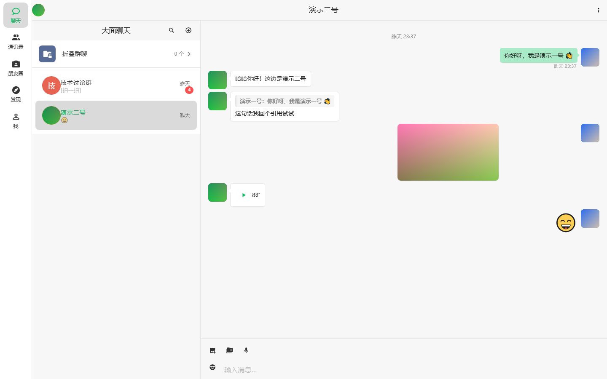

## 4. Group chat message stream

Group realtime messages: system messages (group created / pat-a-pat), text, **@member**,
**group poll card**, images, files. Group IDs are non-enumerable GUIDs — non-members
can't read them (per-entrypoint member authorization).

> **Pat-a-pat works in both private and group chats now**: double-tap a member's avatar in
> a group, or right-click / long-press any of the other party's messages and pick the
> explicit **"Pat"** menu item — no more click-vs-double-click ambiguity.

  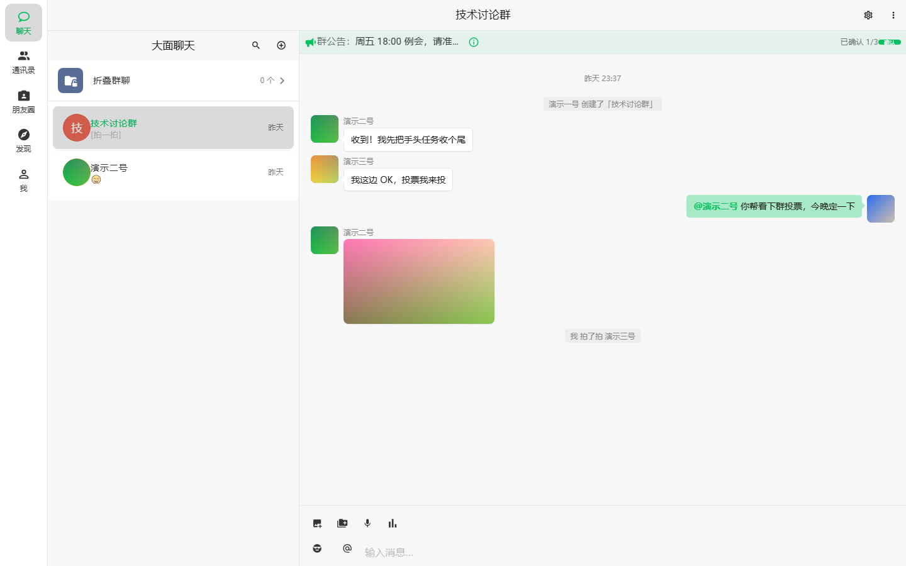

## 5. Group settings

Member grid (owner badge + invite / remove), group avatar, group name, **announcement**,
in-group nickname, **message mute / pin / search history / mute-all** toggles, and
owner-only transfer / dissolve.

  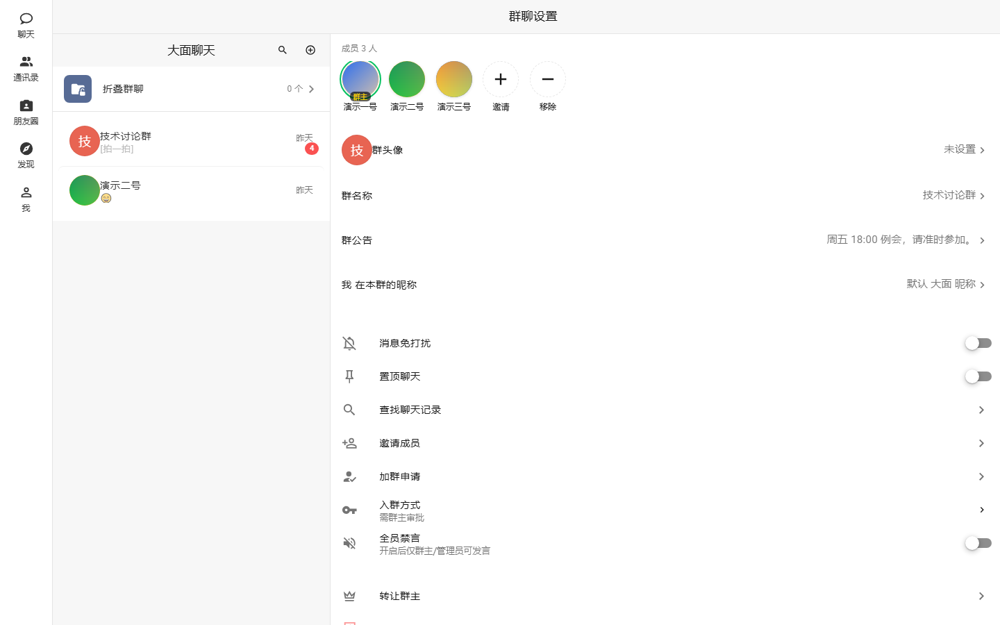

## 6. Contacts

Friend list + member profile cards: avatar / nickname / 大面号 / gender / region /
signature. The "ways to add me" privacy toggles control whether you can be found by
phone number or by custom ID.

  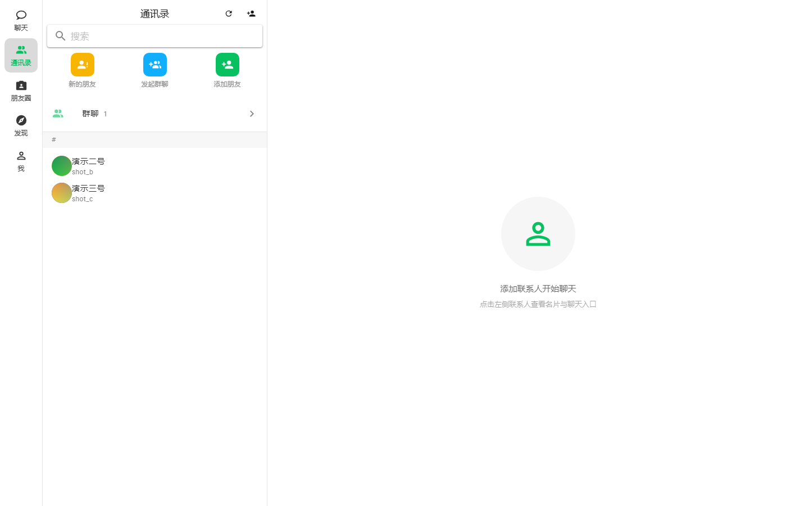

## 7. Moments

Post text/media with **likes** and **comments**, card-style feed.

  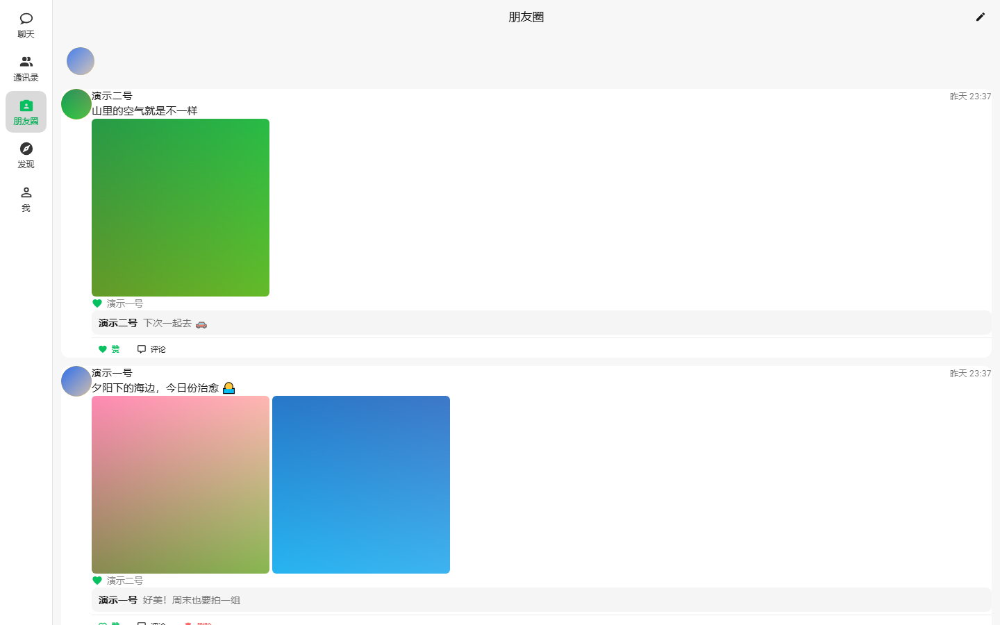

## 8. Discover

Social entry points aggregated in one place: join-by-group-number (QQ-style
apply / question / open / closed), find friends, group discovery.

  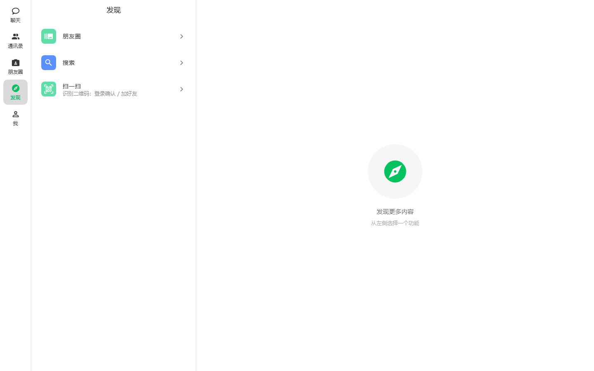

## 9. Global search

Full-text search across **messages / contacts / groups / moments**, results grouped by
type.

  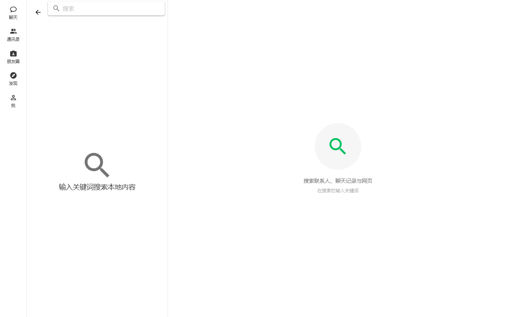

## 10. My profile

Current account profile card: avatar / nickname / 大面号 / email / signature / region,
with editable fields and privacy toggles.

  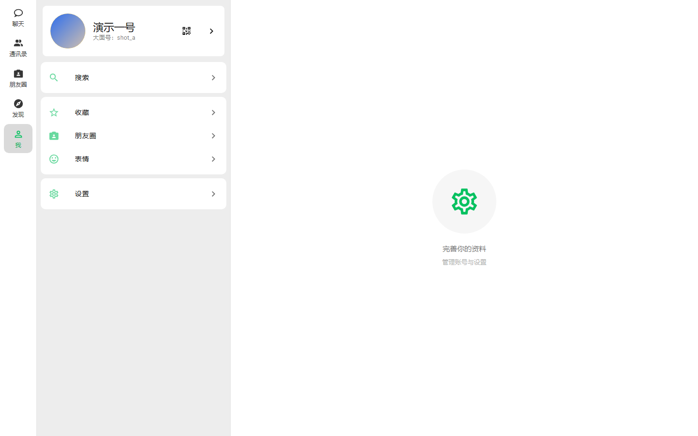

## 11. Settings

Theme color presets, dark / follow-system, UI language, **font size (S/M/L/XL)**,
translucency / wallpaper, privacy toggles, **issue feedback** (sent to the admin GUI),
About (version + build fingerprint).

  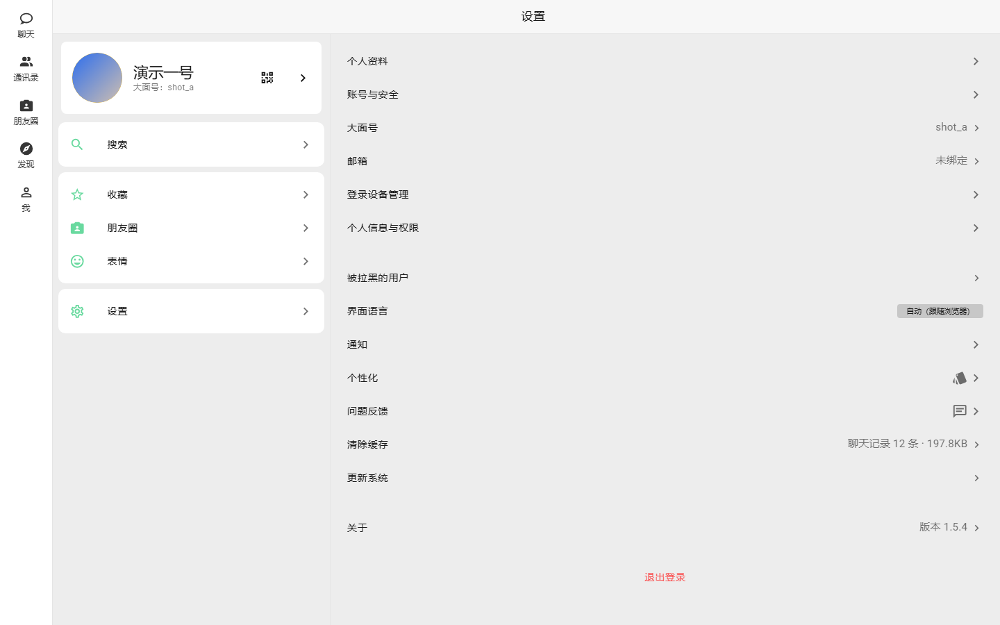

## 12. Dark mode

The same palette auto-adapts in dark; switching is instant and persists (survives refresh /
device change).

  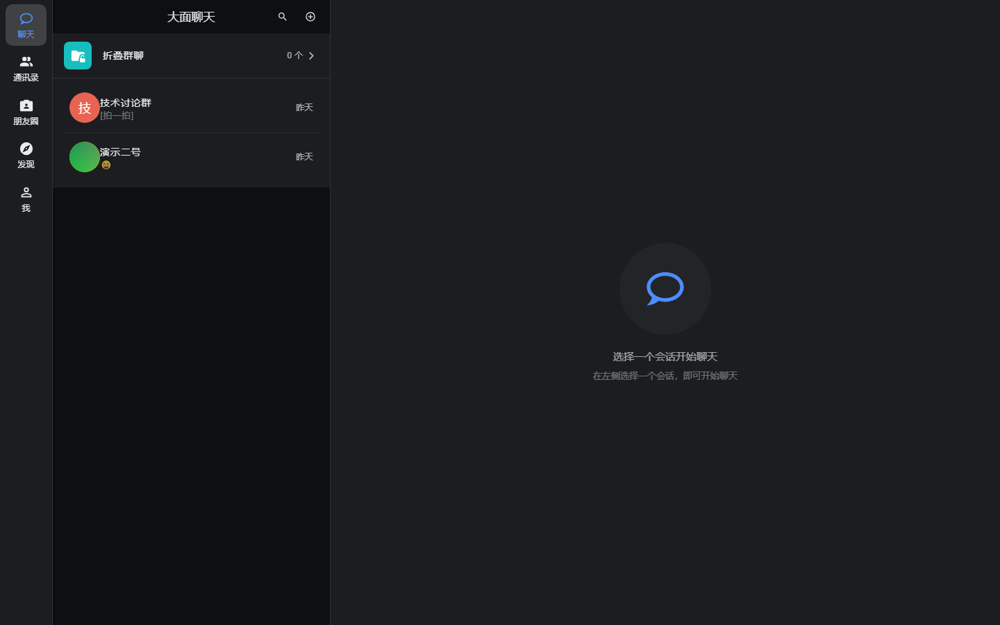

## 13. Mobile responsive layout

The same code auto-switches to a mobile layout at ~390 px: bottom tab bar +
single-column stream. Desktop / mobile share one experience.

  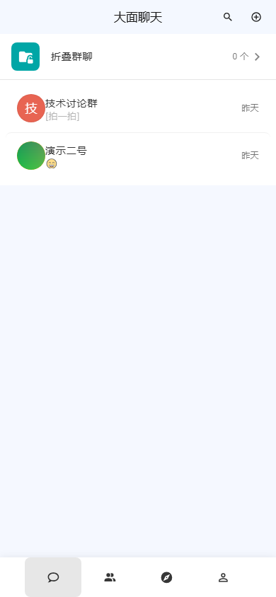

---

> For the full **zero-to-live deployment** steps (3 deploy paths / HTTPS / first account /
> admin-GUI ops / troubleshooting / config reference), read the
> [部署与使用指南 / Deployment & Usage Guide](部署与使用指南.md).
