# 大面聊天 · 功能一览（Damian Chat 界面帮助）

这份文档把**每个核心功能界面**配上真实运行截图，帮你看清「它能长什么样、在哪里操作」。
截图来自一个**全新演示实例**（演示账号 一号/二号/三号 + 一个群 + 朋友圈 + 多类消息），
不含有任何真实用户数据；演示账号在截图完成后已删除。

> 配套：[📖 部署与使用指南](部署与使用指南.md)（从零部署 / HTTPS / 管理端 / 排障）· [README.zh.md](../README.zh.md)（功能总览）
> English version: [📸 Feature Gallery](feature-gallery.md)

## 目录

| 章节 | 界面 |
|---|---|
| 1 | 登录 / 注册 |
| 2 | 聊天主界面（会话列表） |
| 3 | 私聊（文本 / 引用 / 图片 / 语音 / 表情） |
| 4 | 群聊消息流（@成员 / 拍一拍 / 投票） |
| 5 | 群聊设置（成员 / 公告 / 禁言 / 群昵称） |
| 6 | 通讯录 |
| 7 | 朋友圈（发布 / 点赞 / 评论） |
| 8 | 发现（加群 / 搜索入口） |
| 9 | 全局搜索 |
| 10 | 我的资料 |
| 11 | 设置（主题 / 字号 / 隐私 / 反馈） |
| 12 | 暗色模式 |
| 13 | 手机响应式布局 |

---

## 1. 登录 / 注册

首次使用需注册或登录（开放注册时需填管理端下发的**注册密钥**，或后台配置邮箱验证码注册）。
页面右上角版本徽标、滑块 + 图形双验证码、失败锁定都在这一屏。

  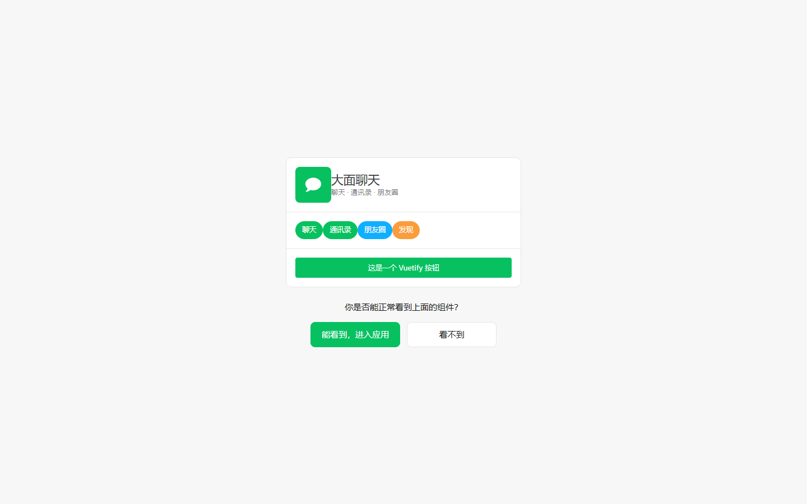

## 2. 聊天主界面（会话列表）

左侧导航：聊天 / 通讯录 / 朋友圈 / 发现 / 我。中间是会话列表，支持**折叠群聊**、未读红点、置顶。
右侧默认「选择一个会话开始聊天」，点开即进入对应会话。

  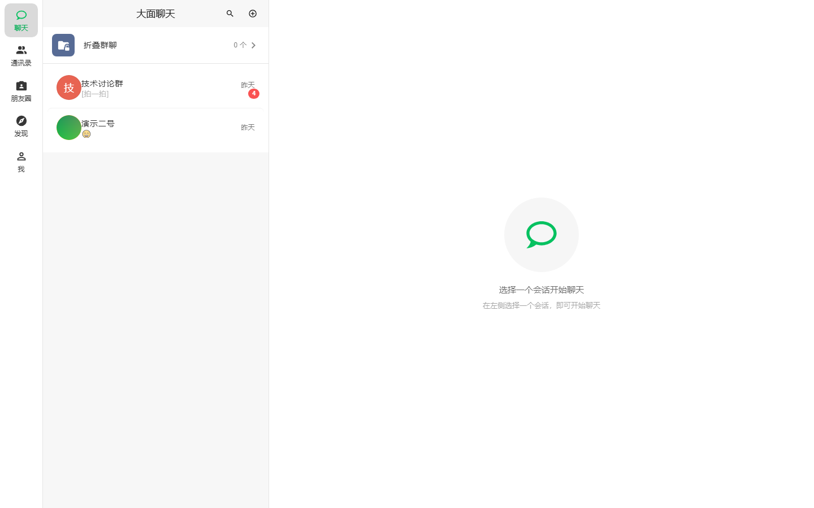

## 3. 私聊

1v1 实时对话：文本、**引用回复**、**图片（等比缩放 + 预览）**、**语音条**、**表情**。
输入工具条（图片 / 文件 / 语音 / 表情）常驻底部。
**拍一拍现在私聊也能用**：双击对方头像，或右键 / 长按对方消息 →「拍一拍」。

  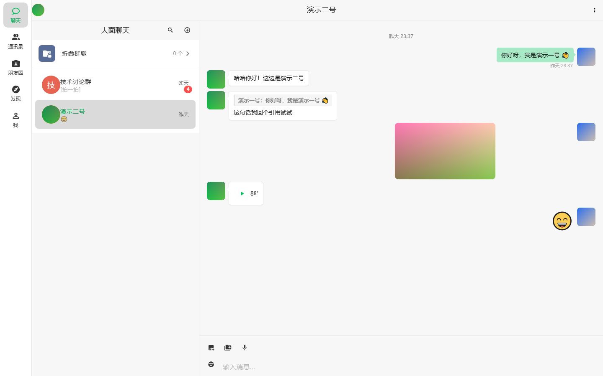

## 4. 群聊消息流

群内实时消息：系统消息（建群 / 拍一拍）、文本、**@成员**、**群投票卡片**、图片、文件。
群号是不可枚举 GUID，非成员一律读不到（全入口成员鉴权）。

> **拍一拍现在私聊、群聊都能用**：群聊双击成员头像拍一拍，私聊双击对方头像也能拍；
> 也可不依赖双击——右键 / 长按任意「对方消息」→ 菜单里点「拍一拍」（手形图标）。

  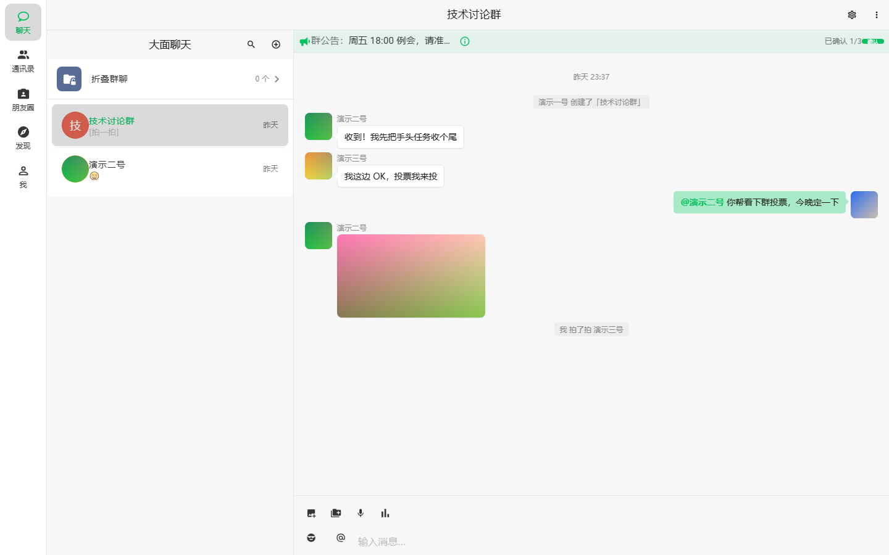

## 5. 群聊设置

群成员宫格（群主徽标 + 邀请 / 移除）、群头像、群名称、**群公告**、「我」在群内昵称、
**消息免打扰 / 置顶 / 查找记录 / 全员禁言**等开关，群主专属的转让 / 解散。

  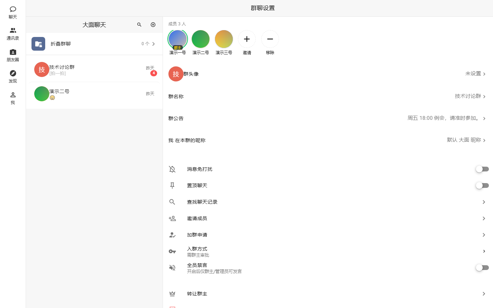

## 6. 通讯录

好友列表 + 成员资料卡：头像 / 昵称 / 大面号 / 性别 / 地区 / 签名。
「添加我的方式」隐私开关控制能否被手机号 / 大面号搜到。

  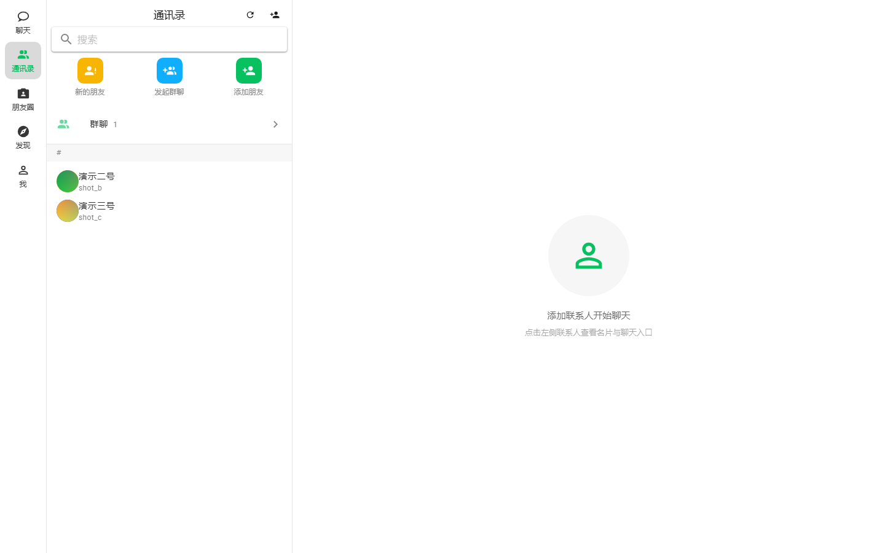

## 7. 朋友圈

发布图文 / 媒体，支持**点赞**与**评论**，卡片式信息流。

  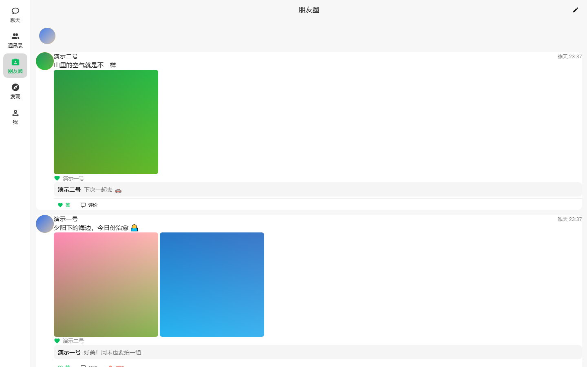

## 8. 发现

加群入口（QQ 式按群号加入 / 申请）、搜索朋友、群聊发现等社交入口聚合页。

  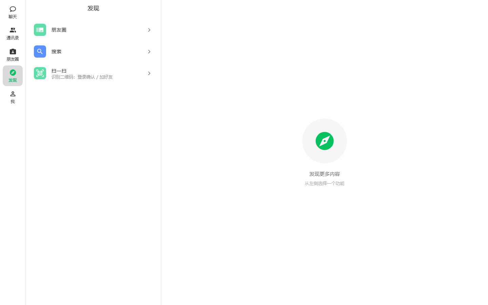

## 9. 全局搜索

跨**消息 / 联系人 / 群 / 朋友圈**的全文搜索，结果按类型分组。

  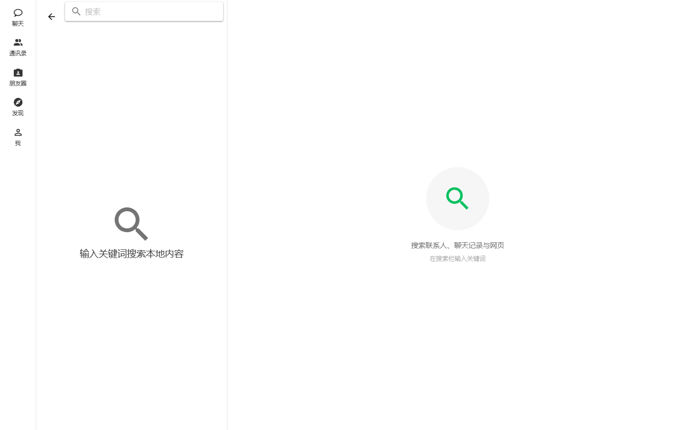

## 10. 我的资料

当前账号资料卡：头像 / 昵称 / 大面号 / 邮箱 / 个性签名 / 地区，可编辑项与隐私开关。

  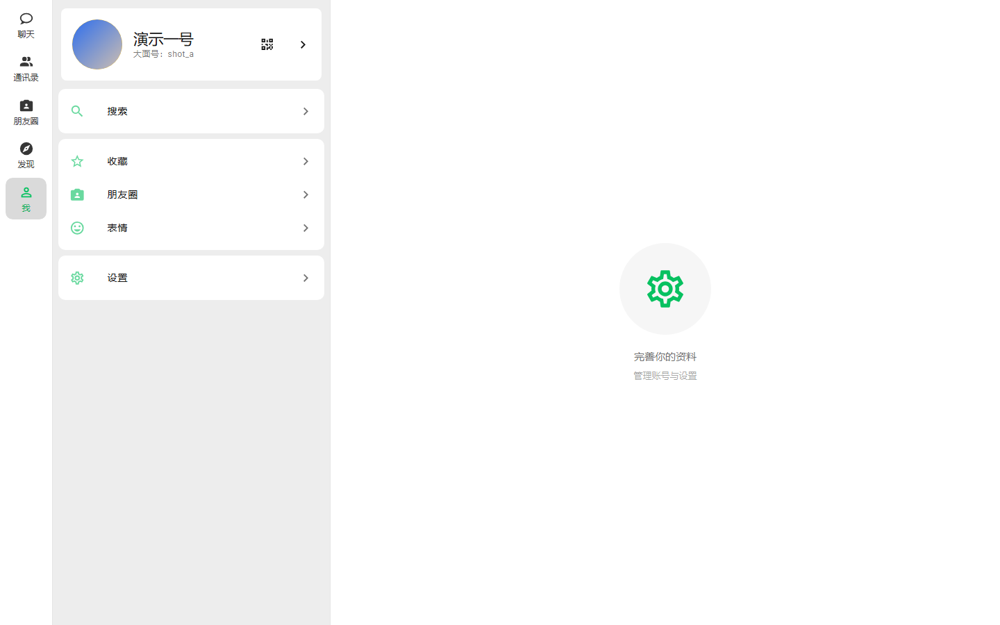

## 11. 设置

主题色（多套预设）、暗色 / 跟随系统、界面语言、**字号（小 / 标准 / 大 / 特大）**、
半透明 / 背景个性化、隐私开关、**问题反馈**（提交到管理端查看）、关于（版本 / 构建指纹）。

  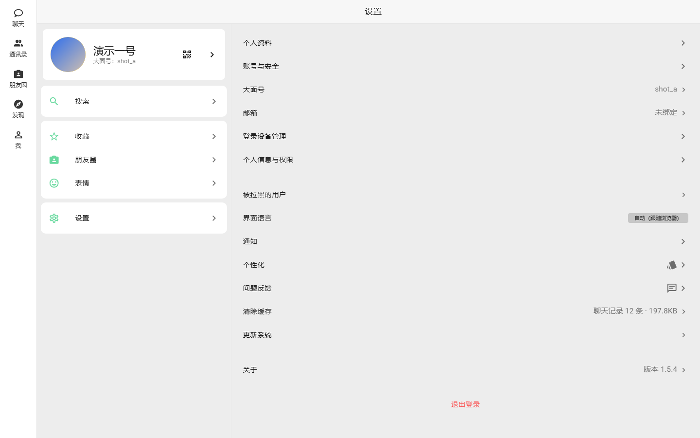

## 12. 暗色模式

同一套主色在暗色下自动适配，切换即时生效并持久化（刷新 / 换设备后保留）。

  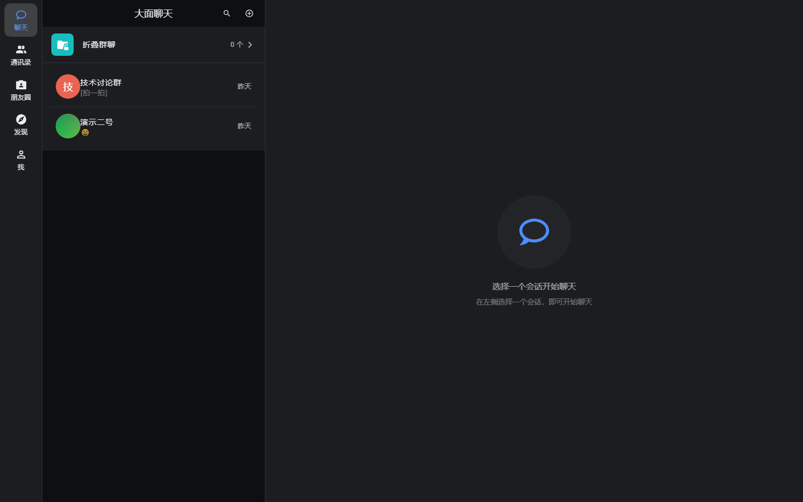

## 13. 手机响应式布局

同一套代码在窄屏（≈ 390px）下自动切到移动端布局：底部标签栏 + 单列会话流，
桌面 / 手机一致体验。

  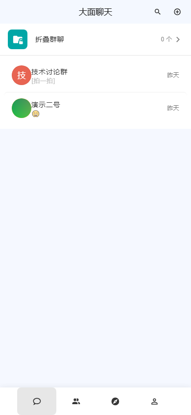

---

> 想要「**从零部署到上线**」的完整步骤（三种部署方式 / HTTPS / 首个账号 / 管理端运维 / 排障 / 配置参考），
> 请读 [📖 部署与使用指南](部署与使用指南.md)。
